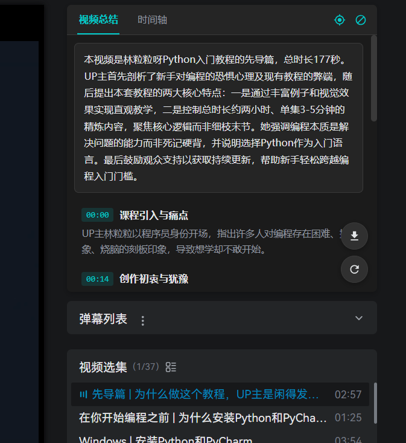

## 用法

打开视频页后右侧栏顶部会出现面板，两个标签页：

- **视频总结**：AI 按章节生成总结，点击跳到对应位置（设置里可以改成点击复制）。
- **时间轴**：全部字幕，当前行高亮跟随播放，广告片段标红。

右下角两个按钮：⟳ 重新生成，⤓ 导出总结为 Markdown。

广告的处理：识别到广告后，默认播放到广告时自动跳过；关掉「自动跳过」就会在面板里问你要不要跳，10 秒不理它自己消失。

工具栏图标点开是开关面板（自动总结 / 识别广告 / 自动跳过 / 点击行为 / 缓存），「完整设置」里有 AI 接口配置和缓存管理。

  

## License

[MIT](./LICENSE)
